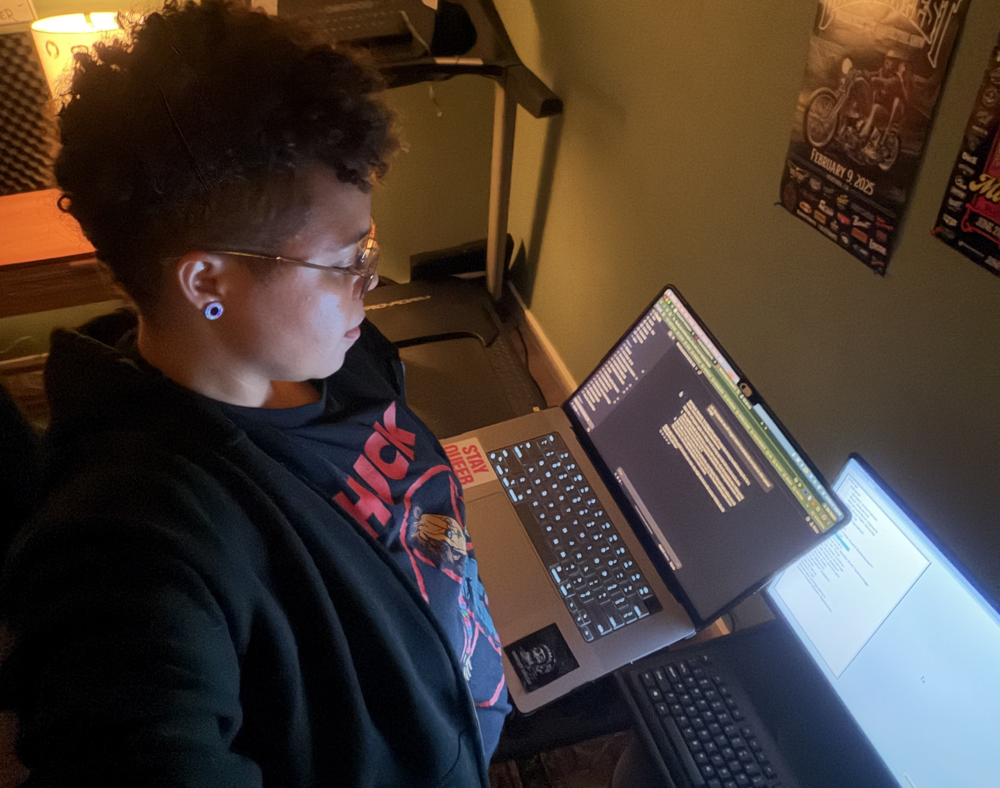
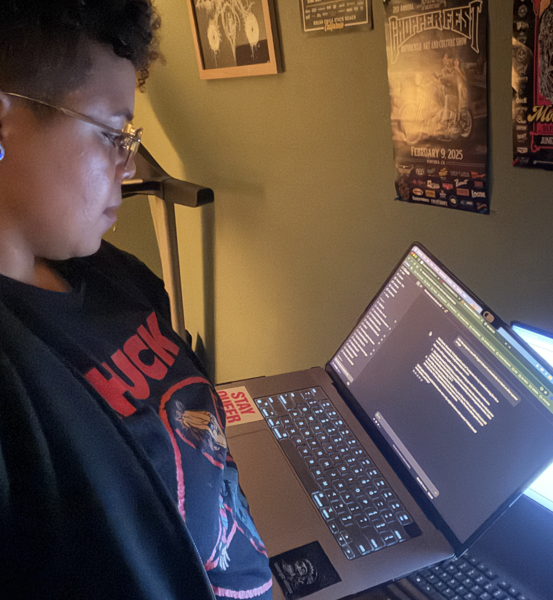

So I just wanted to access an authentic Debian bash shell for Linux Admin class, but uh... my home server never turned back on after a recent power outage. Whoops!

### What I did

This turned into a fun exercise in power outage planning. I was on my couch in the living room going through Linux homework and I decided I wanted to remote into my Ubuntu VM sitting on my home server. But I couldn't connect! I tried pinging it, nothing. I tried troubleshooting, and confirmed that my home server had a static IP, so that wasn't the issue. Even though my home did experience a couple of power outages this week. I initially thought DHCP assigned it a new IP, but as mentioned - it was static.

Claude suggested checking the physical server terminal for the current IP, what a concept! So I scooted off the couch to the location of my home lab in my office and to my surprise... the server wasn't even on! Power was off. Layer 1 troubleshooting, check that the device you're attempting to connect to is actually turned on.

This wasn't the first time this had happened, I just forgot. My server was not configured to automatically turn back off once power was reestablished following an outage. It was time to change that. I rebooted the Dell Optiplex and pressed F2 upon startup to enter BIOS settings, and scrolled down to AC Recovery to enable it. I now will no longer have to physically walk to my home lab server after a power outage to turn it back on.

### What broke

- BIOS setting for AC Recovery was not enabled prior to a power outage and I was unable to remotely connect.

### What I learned

Enable power recovery when setting up a new server rather than wait for a power outage to teach you the consequences of not doing so.

### What else I did

Since I was already in the homelab, I thought now would be a good time to finally set up remote acess to my VMs when not connected to the local network. Like when I'm at school or traveling elsewhere. 

I made a Debian container, not a new VM, to host Tailscale in Proxmox. Tailscale is a mesh VPN that let's you connect from any location. Set up was pretty straight forward. Proxmox has great templates for containers, which are great for conserving storage and RAM. Full VMs eat up more resources, and I just wanted access to a linux kernel outside of my macOS. 

While creating the container I did forget to configure the Network device for it and couldn't access the internet to download Tailscale, an encrypted peer-to-peer connection. This was an easy fix of assigning IPv4 to DHCP so that it pulled whatever IP was available. I did this instead of setting a static IP because Tailscale was going to assign it's own static IP on top that I would be using instead. Voila! My containter had internet access.

### What broke

- Network configs did not have a gateway assigned, needed an IPv4 address to communicate upstream.

### What I learned

That even after all of this... my college network blocks remote connectivity LOL. I'm currently sitting in class on my celullar hotspot as a workaround, oh well.
